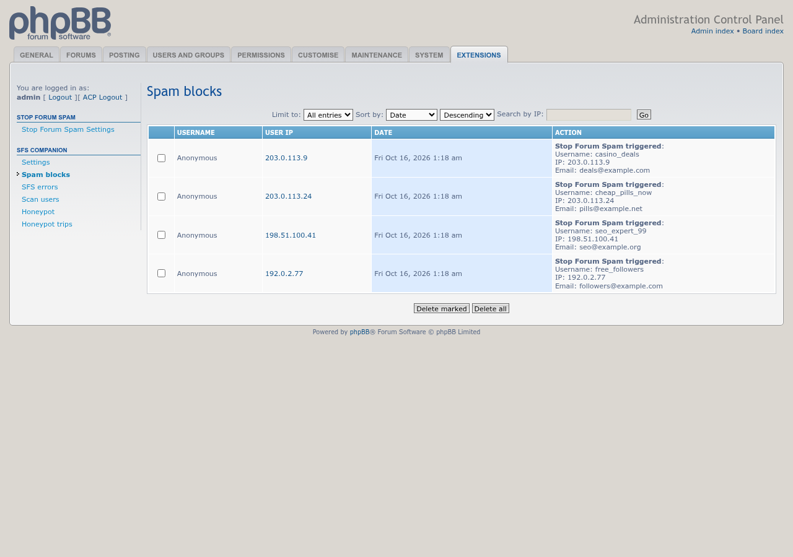
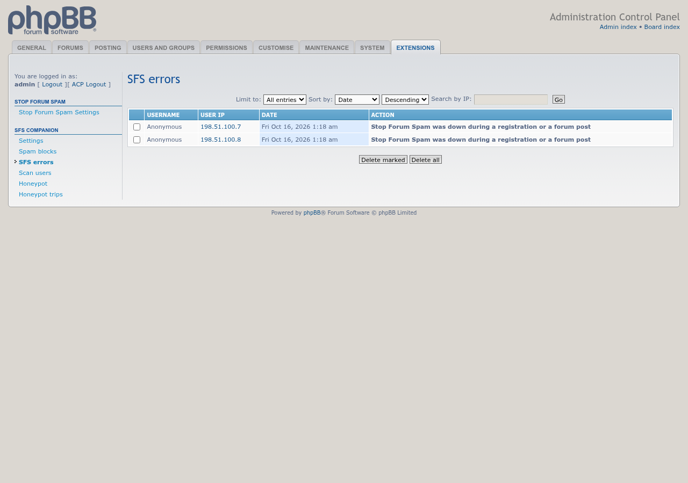
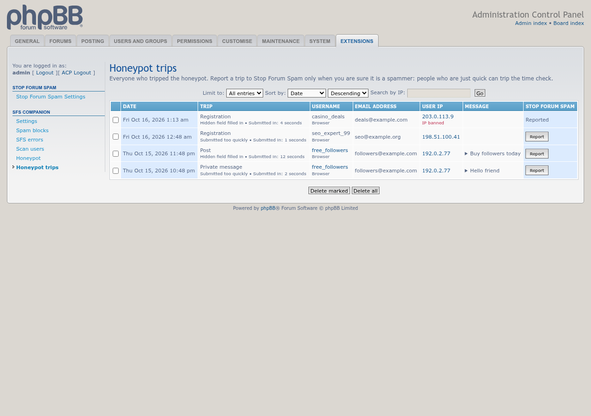
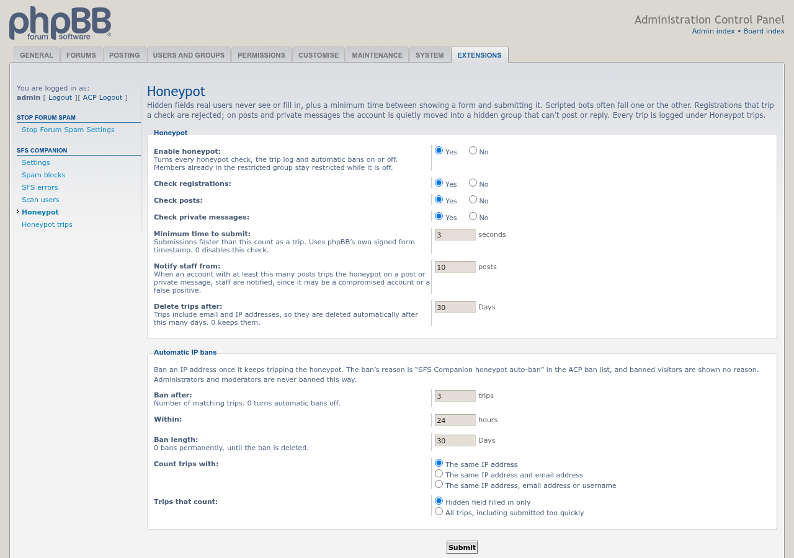
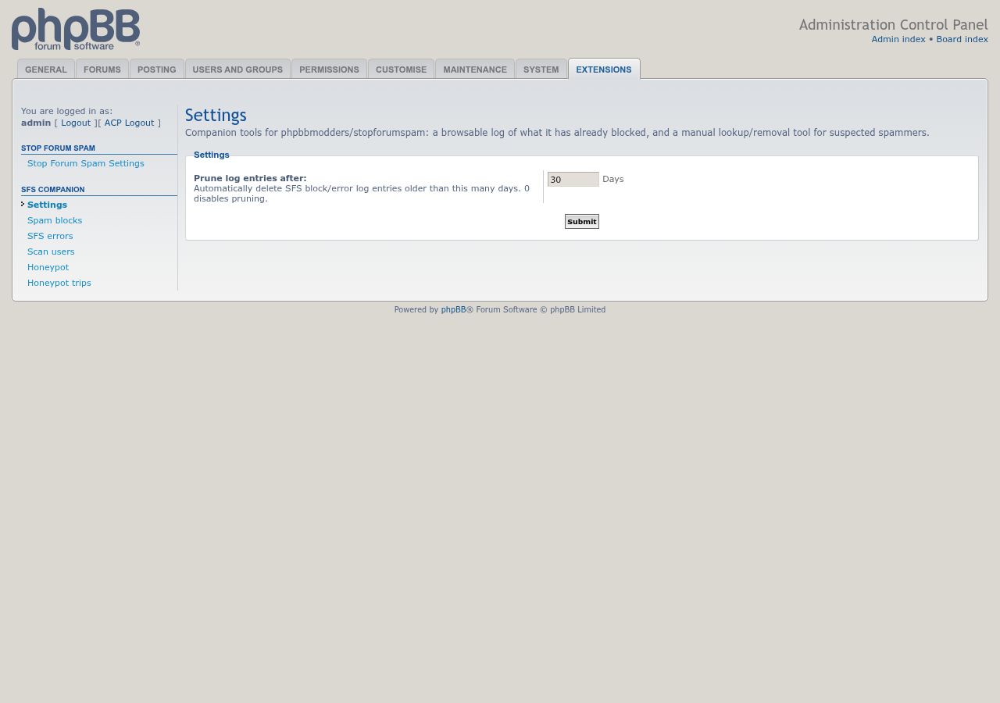

# SFS Companion update screenshots

Captured with Playwright on a disposable phpBB 3.3.19 board on 10/15/2026 (America/Chicago). The board uses synthetic fixture data; the API key shown is a dummy value.

## Spam blocks log

## Stop Forum Spam errors log

## Honeypot trips with synthetic fixture entries

## Honeypot and automatic IP ban settings

## Log retention settings

## Profile lookup link, highlighted

